Planning only works with honesty.

It takes courage to reveal and understand yourself to discover (and rediscover) what routines work for you.

My 2024 started like 2023 with four planners, one dedicated to writing. Then, in March, I started a new day job and career ambitions took priority. As a result, my artistic self suffered along with my mental health, and I abandoned my writing planner.

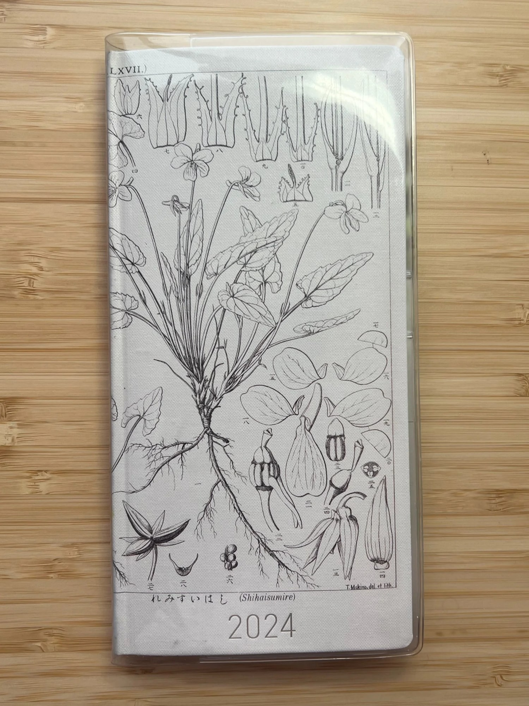
*Abandoned [2024 Hobonichi Weeks by Tomitaro Makino / Shihai Sumire](https://www.1101.com/store/techo/en/2024/pc/detail_cover/wb24_makino/). It was supposed to be flower and Totoro themed.*

In December 2024, I examined my goals, my happiness, and my family non-negotiables. This self-reflection uncovered when I allow myself to devote to my artistic self, this is where I tap into my own spirituality. It's how I mentally recharge, but it's also the most difficult time to manage. When I fully engage in writing or drawing, time becomes a void. I'm submerged in exciting ideas, worlds, characters, and race to jot it all down. It's self love in the purest form.

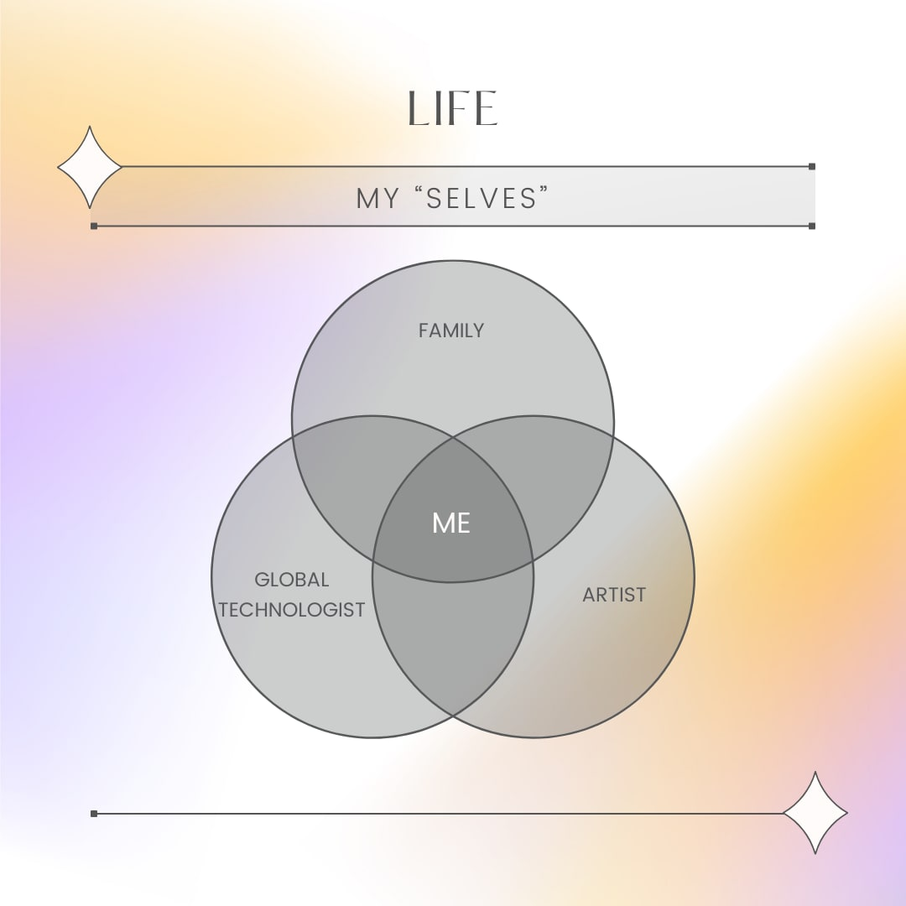
*My "selves" in a fun Venn diagram. I am my family (my why), a global technologist (my funding sources and inspiration), and an artist (my uniqueness).*

Then, guilt, shame, and disappointment wormed their way into my psyche and fractured the good time.

I asked myself with grace and patience: why?

The answer within finally came: unworthiness.

## Limiting Thoughts

I hit a core belief I needed to discard: turning I am unworthy of success into I am worthy **and deserving** of success.

This took months to uncover, but I always knew I was my own worst critic. I just didn't know how severe that critic was impeding my progress. In my research, I consulted many resources, including the Hidden Brain NPR podcast by Shankar Vedantam, The Happiness Lab podcast with Dr. Laurie Santos, following the inspirational legend Viola Davis on Instagram, and reading Atomic Habits, The One Thing, and the Work by Katie Byron, the latter of which the meditations to help uncover limiting thoughts are [on her website](https://thework.com/wp-content/uploads/2019/07/obaat_en_mod_6feb2019-r.pdf).

I practiced at least at the end of the week or end of a difficult day, right before I go to bed, or first thing when I wake up, meditating and journaling on a few core questions:

- What made me feel not great that day?
- What feeling was it?
- When or where was I when it happened?

I kept probing with questions "why?" to uncover the limiting thought.

(Side Note: I enjoy this [emotions list](https://thework.com/wp-content/uploads/2019/02/Emotions_List_Ltr.pdf) to help with character discovery. My stories often start amazingly episodic, but to hit my reader at the core, I know my character needs to "discover" something within – they need to find their own limiting thought and dispel it in the final pages).

This is my honesty with myself.

Now, how do I frame 2025 to be successful, learning 2024 lessons and implementing 2025 improvements?

## How to Plan 2025 (Realistically)

### Examine Life's Rocks

What are your non-negotiables? Think about it:

- What is immovable for you?
- What is foundational to being you?

Here are mine:

- Family
- Wellness

My family takes top priority as does my responsibility for them. This includes how I provide for them in caretaking (being present) and financially (day job). It extends to my aging parental figures as well.

Another non-negotiable became wellness, which I define as exercise, eating habits, and sleep. Consistent exercise alleviates (not eliminates) my mental health struggles. In 2024, I splurged for a personal trainer. It's literally made me stronger and more resilient in mind and body. My eating habits focused on increased protein intake; since, statistically, we lose muscle mass as we age ([article 1](https://pmc.ncbi.nlm.nih.gov/articles/PMC2804956/) and [article 2](https://www.npr.org/sections/health-shots/2024/02/18/1231552773/protein-diet-muscle-strength-training-muscle-loss-women)). As someone who's at risk for osteoporosis, strength training is a must. I aim to consume my weight in grams of protein daily (and it's HARD). It made me more conscious of what I eat.

Coming from a hardworking family and sacrificing sleep for study or work my entire life, this was a hard admission: I need sleep. In fact, all women need more sleep ([article 1](https://health.clevelandclinic.org/why-women-need-more-sleep) and [article 2](https://www.yahoo.com/lifestyle/do-women-need-more-sleep-than-men-230552711.html) which are thanks to research focused on women's hormones and improving women's underrepresentation on clinical studies)

Personally, I need to be in bed by 10pm, or earlier, because I'm naturally an early riser. I'm awake between 5 am - 6 am.  It's partially by choice because it's quiet in that hour; I'm at my most creative, and I'm fully alone (barring any children sleep issues).

These form the parameters around my goals.

### Curate Your Ambitions

Think of yourself at 80 years young. Immerse yourself in that setting. You've accomplished everything you've thought impossible, and more.

- Where are you?
- What's on the walls of your home?
- Who's around you?

In 2024, I allowed myself a 30 minute meditation ruminating on this, wrote it all down, and revisit it every few months.

In my elderly future, my children don't have to care for me. I've created a legacy of impact of which they're proud. They have inherited wealth. I have paintings I've bought and made that adorn my walls. My bookshelves have my works in them. I still write, draw, paint, and play music. Maybe I've made a short animated film. I have technology to assist at my fingertips, and enabled technology to assist those with greatest needs, not just those who could afford it.

These became my goals:

- Artistic Self
- Technical Career

These are my guide posts, my life's work outside my familial and health obligations.

These are my focus.

### Excavate Your Time

Routines only work if they're real. Planning and tracking helps you excavate the time you really have to achieve your goals.

I take my life rocks (family, wellness) and pit them against my goals (artist, engineer) and then add third dimension: time.

I breakout 2025 into quarters. I quickly realize Q1 has significant work deadlines, Q2 and Q3 will be tough with family vacations, and Q4 is shot with family obligations. I time block that out. I step back and see which months I will give myself more grace.

Then I look at my day. What time of day am I at my best? When do I eat? When do I work or devote time to my family? What's leftover?

I approximate 10-12 hours a week for my artistic endeavors and career planning.  Is that really enough time? In 2024, I spent most of that time, which was more like 5-6 hours a week, on career planning and way less on creativity work. In 2025, I plan to focus on getting an average of 8-10 hours a week back, with 5-6 on my creative work.

I also refuse to be upset with myself for dynamically reprioritizing my family when they need me. They are my why.

With that, think about:

- What are your quarterly rocks (time blocks)? monthly?
- What are your daily rocks?
- What are your hourly rocks?

### Choose Your Planner

Finally, my favorite part!

I'm a stationary snob and through **years** of trial and error, I require my planners have the following features:

- Thin paper
- Resilient to fountain pens and ink
- Monthly, Weekly, open notes page
- Minimal to no decoration

I tried [bullet journaling](https://bulletjournal.com/) in 2015 but it took up too much time.  I moved onto [Hobonichi planners](https://www.1101.com/store/techo/en/) in 2017. I adore Tomoe River paper, but sadly, I do not love the newer Sanzen paper in production since 2023. In 2024, I stickered over previous years' planners to make them 2024. It took far too much time.

In 2024, I purchased a [Sterling Ink](https://sterling-ink.com/) Common Planner second-hand, confirming how much I hated the Sanzen paper. My favorite pens and inks bled through the pages.

In 2025, I've made peace with it and switched to Sterling Ink.  These are the planners I use:

- Pocket Horizontal Compact (in tweed with gold edging) for tracking expenses, workouts, and miscellaneous
- N1 Standard in Horizontal Full (in mulberry with gold edging) for meditation/writing
- N2 Weekly Horizontal Compact (in camel with gold edging) for work and career
- A5 Horizontal Full (in mulberry with white edging) for family "trash" journal
  - My kids call it my "trash" journal since I often paste boba tea plastic lids,  paper wrist bands, or even candy wrappers to celebrate the day or event we experienced as family.

### Writing / Meditation / Me Journal

I decorate my planners. I use stickers, washi tape, and vellum that are inspirational or just cute.

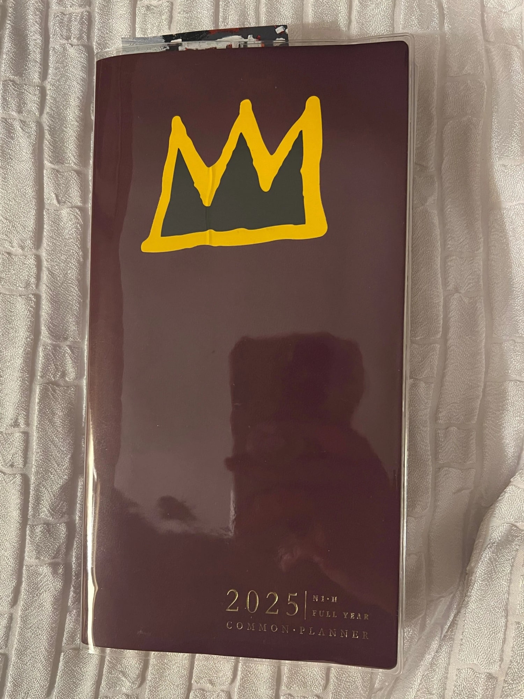
*2025 Sterling Ink N1 Horizontal Full Year in Mulberry with a sticker nod to Jean-Michel Basquiat.*

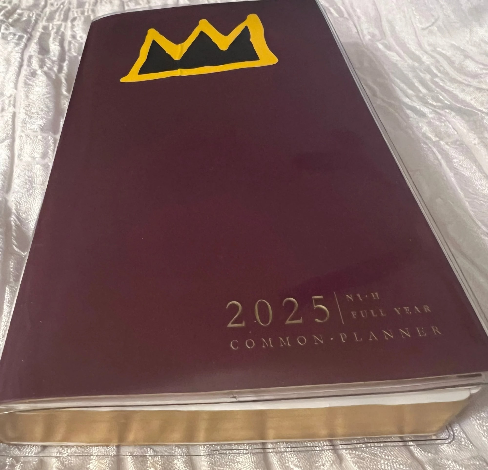
*Look at that gold edging!*

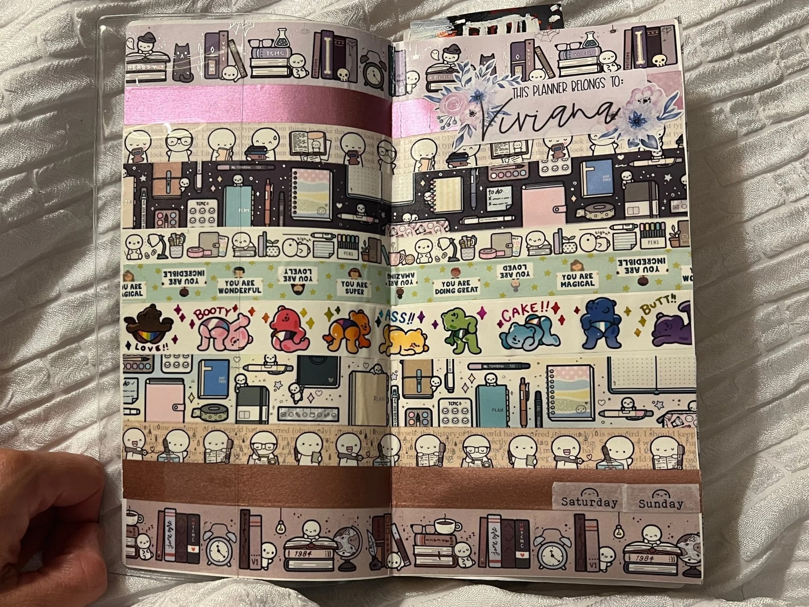
*On the inside cover, I use several TCMC washi tapes and a few amazing indie washi I purchased at the August 2024 Yoseka Stationary Fest.*

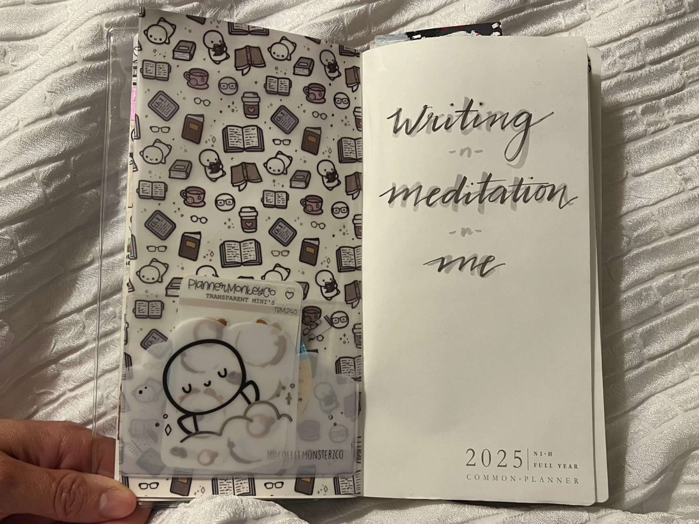
*On the first page, I used TCMC vellum and a plastic pocket sticker to hold little stickers. I also love Planner Monkey Co stickers.*

I actually started with a page in the Notes section, freewriting in a "Brain Dump" page. I started by staring at a blank page. I turned on some music (I recommend [this Tiny Desk concert](https://www.youtube.com/watch?v=9kqnsoY94L8)) to engage my subconscious, my free creative mind, and detailing everything that comes to mind.

It gets overwhelming but what I want to arrive to is:

- What are the main groupings I want to accomplish?
- What will make me feel proud of myself as an artist?
- What do I envision myself achieving by December 2025?

This is what it looks like:

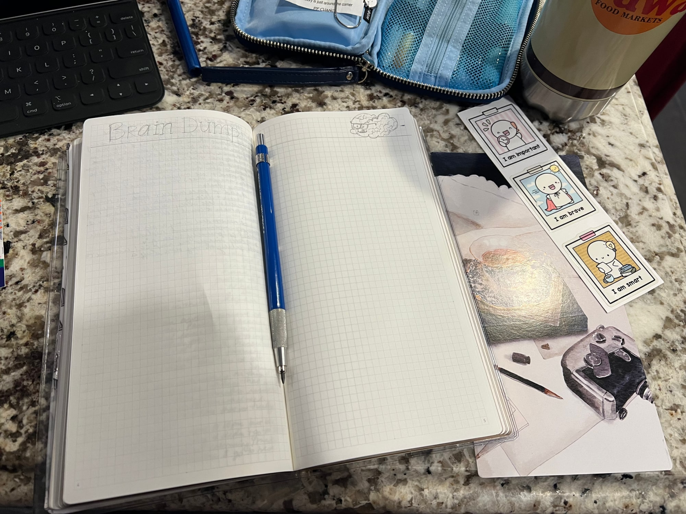
*Brain Dump page in pencil pre-populated.*

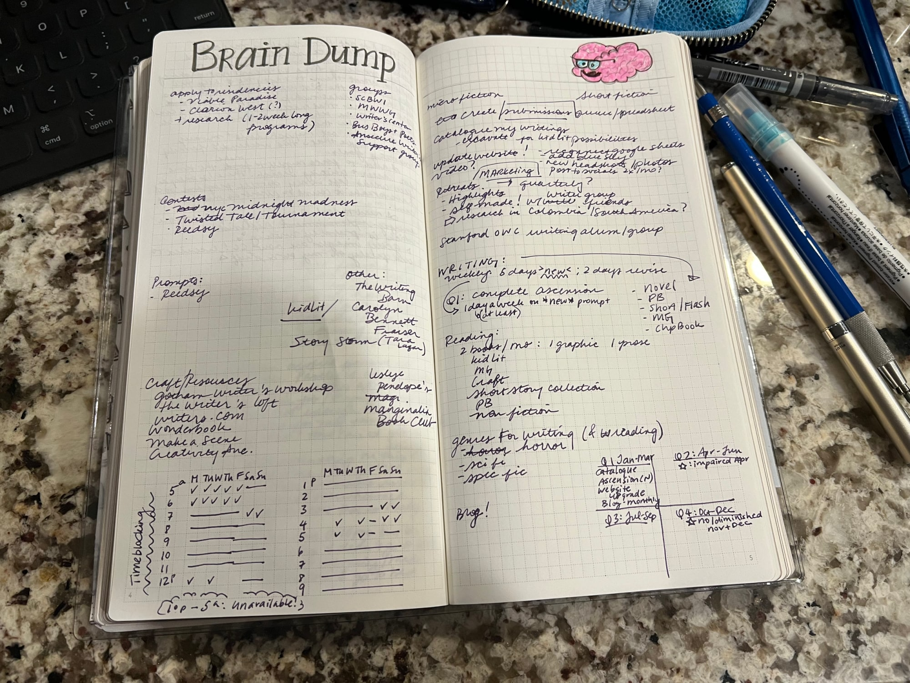
*Brain Dump page completed. Note the Joker-esque smile on the pink brain (thanks Sanzen paper that the marker didn't dry all the way before I added ink).*

My word for 2025 is: FOCUS. It's a page I leave empty at the start of my planner's Notes section where I write the word and decorate with inspirational doodles, stickers, or other ephemera throughout the year. Here's what it looks like:

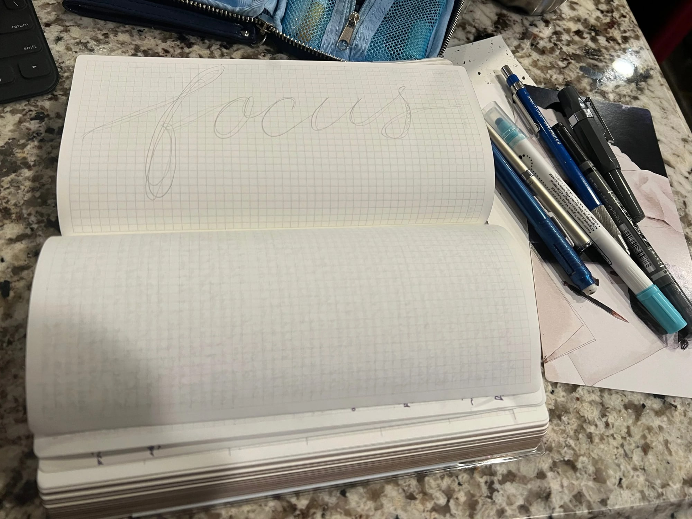
*FOCUS in pencil*

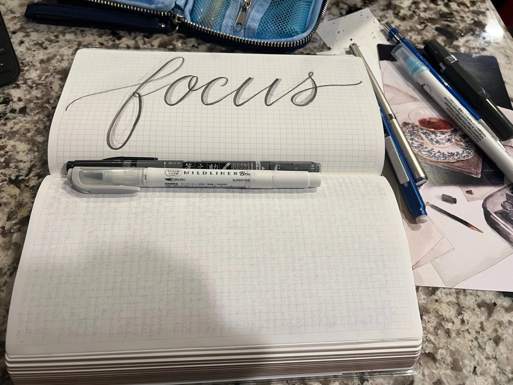
*FOCUS in pen and marker, ready for colors!*

Now that I know my goals and realistic timelines, I can break those goals further into achievable objectives throughout the year. I use the Quarterly pages in the beginning to plan and track these. It's still something I'm developing and will continue to refine.

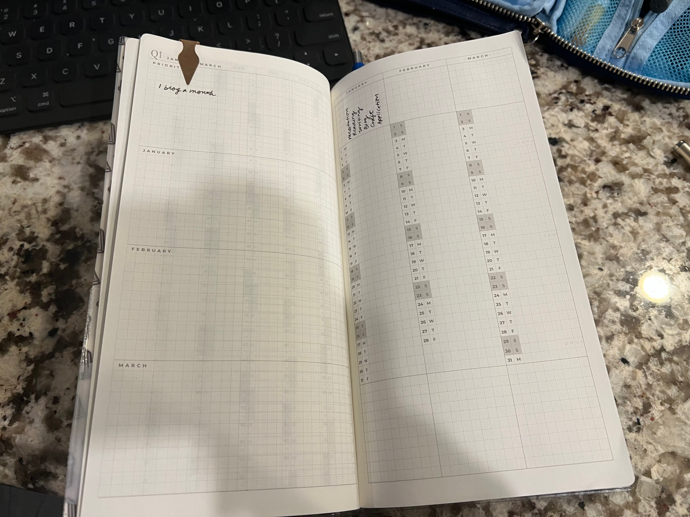
*2025 Q1 in a monthly and daily trackable format.*

What I love about the weekly layout is I can restart every week. It's a continual trial and error until I find what works until that doesn't work any longer and then I adjust. Here I take note on the time I spent on writing and reading and any ideas I have for a future or current project.

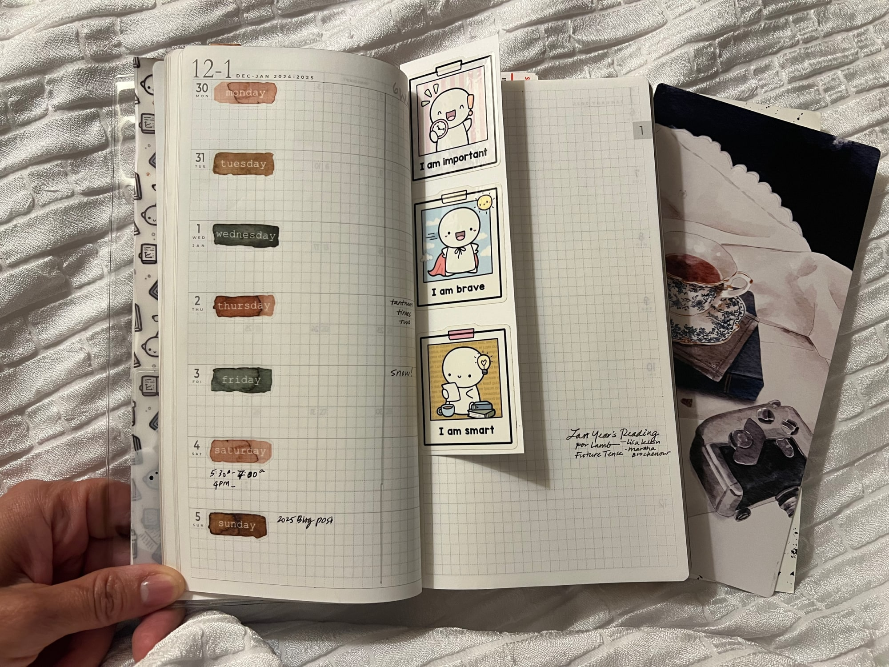
*First week in 2025! It's a trial run.. and I'm still working on the format…*

It ends as it begins, decoration-wise at least.

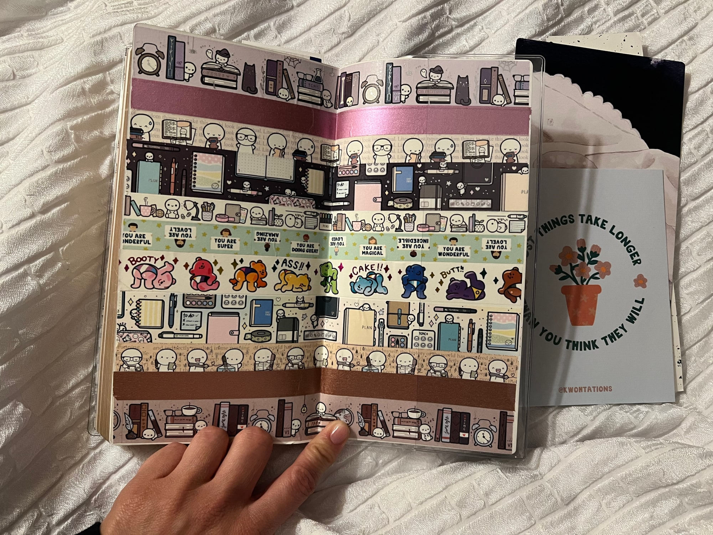
*Back cover decorated like the front cover.*

It's not perfect but it helps me keep accountable with myself. After all, this is my year of FOCUS. This is my year to complete my projects and re-prioritize my artistic endeavors.

It's my 2025 self love journey.

I hope this helps you and gives you some inspiration for your process and your self love journey into 2025.

What can keep me accountable is posting an update on my progress. Maybe even a resource for those to find amazing artists to support.

Here's to me and you in 2025!
