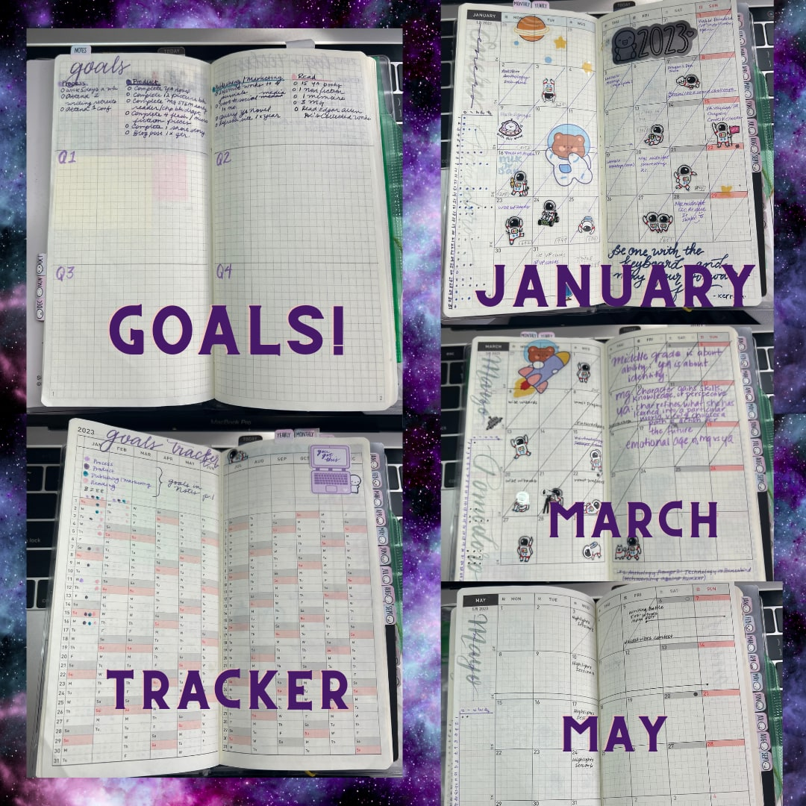
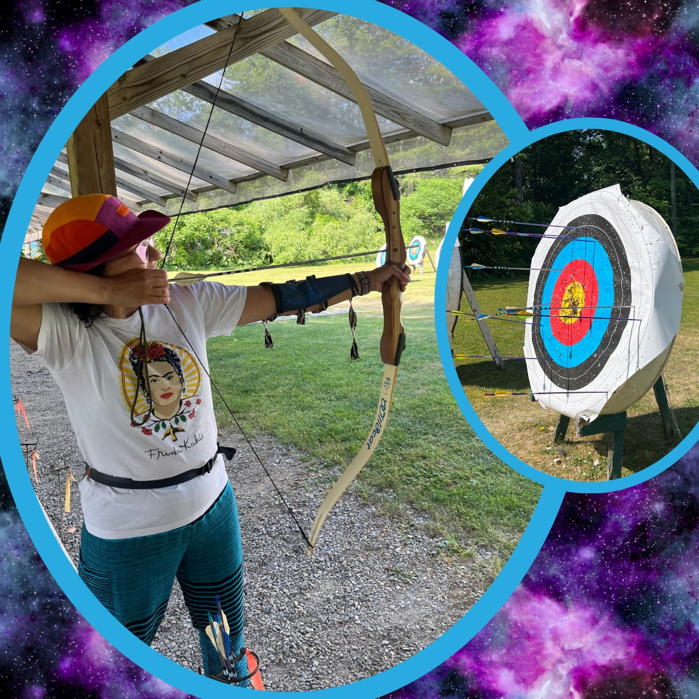
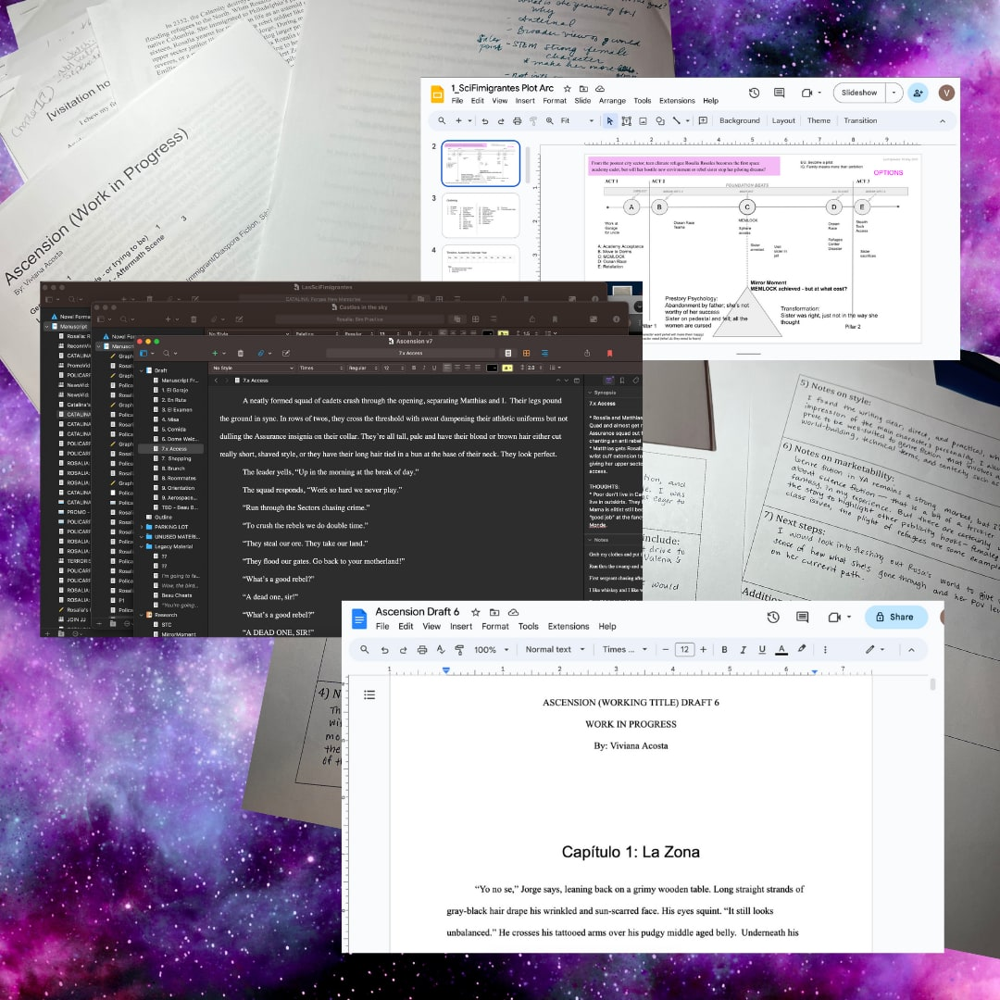
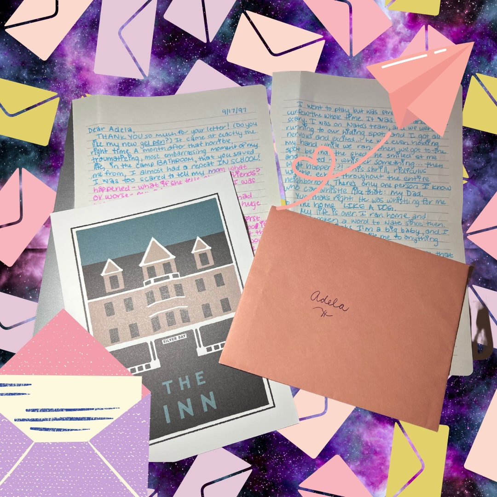
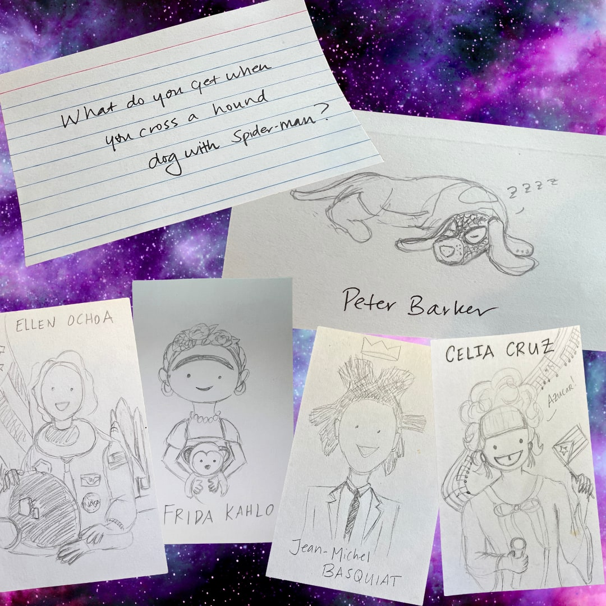
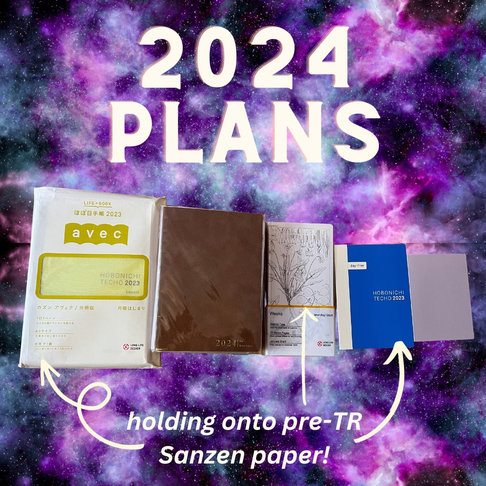

Today is my birthday.* 

Today I am Douglas Adams’ answer to the universal question: 42. 

What was the question? 

*Where real life sucker punches my dreams*

---

Today, the questions elude me. Like a dog who walks into each room asking, why am I here again?

My mind is frazzled. All. The. Time. 

Enter: [my planners](/blog/planning-for-2023/). (Yes, that’s plural). Why? Why to meet my goals, of course. Goals I set for myself at the end of the calendar year for the upcoming year, only to be reminded of around my birthday in the late third quarter, that I have had pretty much no chance of achieving.

Despite the frenzy of life as a full time working mother at a demanding job with two young children and as equally as demanding (and often more destructive) dog, I set goals for myself. Only for my reality to sucker punch them into oblivion.

For planner enthusiasts (I see you!), September is a time of rejoicing! We select our next year’s planners and if you’re picky (ahem, I am perfectly comfortable being known as a snob) like myself, you only use the best paper that your elitist little heart can afford: Tomoe River paper. My favorites are Hobonichi and Sterling Ink planners, but I digress.

What I get most excited about with the fresh new planners is dreaming up all the scenarios of how I will accomplish all these goals. SMART goals. 

Today, I reflect on what were my 2023 goals and 1) what can I possibly do about them now and b) what reality-adjusted goals should I start for 2024? This post is focused on writer-author-me goals. **

## 2023 Writing Goals Review

On December 27, 2023, using a Hobonichi Weeks planner for writer-me, I defined my goals and left quadrants blank to show how I achieved those goals in 2023. As is evident here in Q3, I never went back in and filled out my progress per quarter which was supposed to motivate me to achieve said goals into the next quarter and/or adjust the goals to fit the reality.

*2023 Hobonichi Weeks select pages*

Progress:

- Write 5 days a week
- Attend 2 writing retreats
- Attend 1 conference

Product:

- Complete my YA novel draft
- Complete 12 picture book manuscripts
- Complete MG STEM early reader/chapter book
- Complete 4 flash/micro fiction pieces
- Complete 1 short story
- Blog post 1x/quarter

Publishing/Marketing

- Submit words to 4 journals
- Post to social media 1x/month
- Query YA novel
- Refresh website 1x/year

Read

- 15 YA novels
- 1 non fiction
- 1 memoire
- 3 MG
- Edgar Allen Poe’s collected works

The thing about these goals is that December 2023 me, or really any time me, has no real guage of reality me. Often, I sit down with maybe an hour to write and want to work on 3 of these goals and barely start on 1 of them. Sometimes, I stare into the void beyond my computer screen, willing my work in progress to make sense, and contributing maybe 10 words during the writing session. And it’s not on the actual manuscript but thoughts on what I can do to improve it. 

The usual culprits of productivity suck include: exhaustion and distraction. Did I pack snacks in my kid’s backpack for school tomorrow? Did I delineate expectations clearly enough at work? When’s the last time we changed the bed sheets? Do I have to go into the office, and if I do, did I make doggy daycare reservations? Do we have enough eggs? Do I have clean socks to run tomorrow? Are the kids’ soccer uniforms clean? *Yawn* Oh look, 40 minutes have gone by according to the clock in the upper corner of my screen and I have maybe 20 minutes to try to write, edit, or review craft.

*Lucky she’s cute…*

Intrusive thoughts barrage my mind and quieting the storm is impossible. It’s more like I find eyes of the storm for calm, for either productivity bursts or feeling like the “other life me” responsibilities are taken care of (by endless lists and shared documents with my partner and family to assist). 

Still, I stick to it. Any thoughts or words is progress towards achieving my goals. Writing, being an artist, is my life dream, my vocation, and just like all skills, even those that I have a natural proclivity towards, I have to put in the work. What sucks is the work can only be achieved around the mom-professional roles I play in this life. 

## Reality Check

How’d I do here at the end of Q3? 

## Goal One: Progress

Since the summer, I found waking up at 4:00 -5:00 am and writing first thing gets me the best results. Then, I try to write in the evenings from 9:30pm - 10:30 pm/ 11:00 pm and repeat the next day. My goal is to execute this routine 5 days a week. It nets me an average of 4-5 hours of sleep a night, from Sunday through Thursday. Friday and Saturday I usually crash at 9pm, as soon as I sit down on the couch after putting the kids to bed. Yet, I wake up at 4 or 5 am, on my own, because the stories in my mind are bursting to be told.

It’s not sustainable, but it’s a drive, a passion, that I think only other fellow time-starved creatives can relate to. Or so I tell myself. 

Other goals? I did make it out to a retreat hosted by Eastern NY SCBWI in June 2023, and it was beautiful. I finally met one of my virtual writer friends in person. 

*Lake George, NY is beautiful and the perfect setting to learn archery.*

I’ve taken a few virtual craft classes but didn’t attend a conference this year and probably won’t at this point, vacation time being scarce. I applied to a few retreats for next year so maybe that’ll work out! I also don’t think a conference is what I need; I just need space and time to write and maybe a mentor or a coach to champion me.

## Goal Two: Product

Whelp, my YA novel manuscript is still a work in progress.

*Myriad of Scrivener files, Google docs, journaling, feedback, .. etc.*

I’m currently editing/re-drafting Version 7, but after *6 years* I finally have honed in on the actual story. After participating in the Highlights Foundation inaugural Just Do It class with Chris Tebbettes and Sarah Aaronson, I learned a new motto: STORY IS BOSS. It goes beyond “killing darlings” but honing in on what I *actually* want to say in my story. It helped shed light on the critical path for my narrative, and let fall away the plot points and spurious characters and situations that are great, but, ultimately, don’t matter.

After close to 150,000 words already written, I discovered, I really had only about 30,000 worth keeping or reshaping. Now it’s time for the real work to start. 

My other pieces? I started an MG novel in letters with a dear writing friend, where my character is sixteen and their character is twelve and how, despite age differences, they strike a friendship and learn from each other.

*Snail mail! Evoking 1990s middle grade and teen angst with gel pens.*

I did several NYC Midnight Madness flash and microfiction competitions and the Writing Battle flash competition, netting me three flash pieces. I tried a few other prompts and have two unfinished short stories. Picture Books? I’ve done maybe two with several noodling around in my head.

Blogging? Ha, this is my very real evidence (missed one in 2023). 

## Goal Three: Publishing / Marketing

If you follow my instagram, you’ll see I mostly post my kids’ #lunchboxdoodles. I scour the Internet for an age-appropriate joke and draw a cartoon around it. 

Various pencil doodles that I’ve made for my kids’ lunchbox. Celebrating Hispanic Heritage Month 2023 with portraits of famous hispanic / latinx(e) people for inspiration.

I wish I posted the screenshots for successful submissions for competitions, but I’m usually smashing that submit button at 11:59 PM when it’s due at 12:00 AM and fall asleep promptly after.

I’ve been rejected by a few journals and competitions, but I am grateful for the deadlines and products. I don’t consider those losses!

The website? Well hopefully that can still happen this year. I’m going to get some real headshots taken, and not using my iphone set up in precarious positions and then heavily editing the photo using Canva.  That combined with the new JWST images, I have some ideas on how to refresh the look.

## Goal Four: Read

I’ve read a lot this year and for those who think audiobooks don’t count, it’s the *primary* way I read now. When I try to read either on my phone or a real paper book, I fall asleep within fifteen minutes.

I’ve read more than 15 YA books and more than 3 MG books. The latter is thanks to my daughter who’s starting to read into that space. I read to my children every day and weekly we return between 30-40 books to the library and take out as many too, mostly picture books and early chapter books.

I need to read a memoire and non-fiction, but those are true stretches and struggles for me. I want to find another “The Man Who Moved the Clouds” memoire to inspire and awe me; otherwise, I’m sorry, these put me to sleep and my already fractured attention span has no hope.

*Edgar Allen Poe is probably not everyone’s go-to for middle grade horror, but I’m so glad he was mine!*

I love Edgar Allen Poe. I think the first work I read of his was the Telltale Heart when I was about ten. But, outside of reading the Raven to my kids and watching the Simpsons’ take on it a few times, I have not touched Poe’s works. Might have to happen next year when hopefully my longer works will be more in the horror vein.

## End of Year (EOY) and 2024

*2024 Planner Stack (so far)*

Overall, I did ok! The realities though are to adjust these expectations for next year and whittle the goals into probably just 4 overall. 

I want to actually draw more and hone in that craft. Maybe take some classes with my kids and lose myself in painting like I did pre-children. I miss the peace of mind and meditative restoration that afforded me.

So in 2024, my main goal for my artistic soul is:

- **To give myself grace to fit my reality**

---

\* Ha, just kidding. It was a few weeks ago. 

\*\*For those interested, my other planners are for: 

- family journaling (like a modern scrapbooker-meets-archivist) in a Hobonichi A5 Cousin,
- writer-me planner in a Hobonichi Weeks
- daily drawing (only drew daily in January and February) in a Hobonichi A6 Techo, 
- work in a two-book B6 Wonderland planner (after 9 months, I abandoned first book with monthly and weekly components), and 
- the “me” journal which is a half used Sterling Ink B6 Common Planner. 

Next year, I plan on:

- family journaling:  a 2023 Hobonichi Cousin Avec with renumbered days to match 2024 because I want to make that non-TR Sanzen paper to last forever. I’m changing it up and using an Avec for two books instead of one since my current Cousin is about 6 inches thick. It’s pretty impossible to write in thanks to all the pasted ephemera.
- “me” planner: cutting **(gasp)** the unused half of the 2023 Sterling Ink B6 Common Planner blank pages and adding a 2024 Sterling Ink Monthly Booklet to track health and exercise habits
- writer-me: 2024 Hobonichi Weeks, keeping in tradition since 2020
- day job: a 2023 Hobonichi A5 Day Free for work - also renumbering the days to match 2024, and finally,
- “catch all:” a 2024 Sterling Ink Passport “Slim” for daily doodling to throw in my bag.
