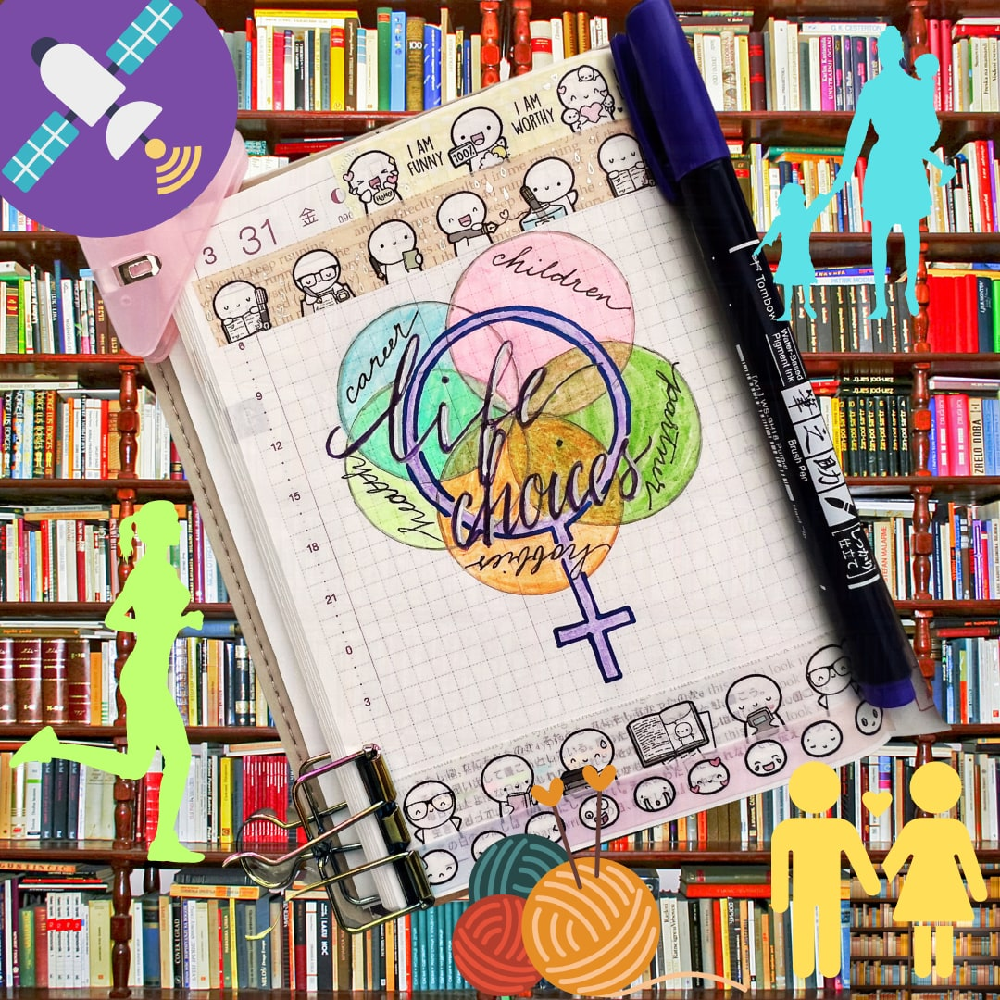

**Where the Glass Ceiling meets Gaslighting**

Writing is not a hobby; it’s a vocation. Unfortunately, living in a capitalistic American society that undervalues art, there is no equivalent earning, healthcare, or retirement benefit potential between my writing and my engineering day job (not yet at least). 

*A working woman’s life choices evolve and are limited by her energy and support structures.*

As a working female, my life choices include: partner, children, career, health, and hobbies, or activities that enhance my life or attempt mental respite, like doodling or knitting– never writing. Thanks to a demanding job and young children, I write in the margins of time I steal from sleep, exercise, and gaps in my meeting-filled work calendar.

At late night writing groups and in day job managerial check ins, my well-meaning coworkers, bosses, and fellow writers ask the innocuous question of, “How’s it going?” Most days I smile and nod and lie and say “fine” with trained facial features, and some days I can’t hold the veneer and foolishly tell them the real answer which is “fine” through gritted teeth and a twitching eyelid.

Their reactions range from ignoring me to sighing, slow blinking, and with a disapproving head shake, they’ll say, “life choices.” They’ll laugh after such a cruel utterance and then still ignore my mental state and forge ahead with the meeting objective, leaving me to compartmentalize my anger and shelve it away, like I have with all uncomfortable emotional reactions my whole life.

Once upon a time, success to me meant multiple homes (each multimillion dollar residences with the vacation home really being a vacation island), being an executive at a Fortune 500 company, and having three children (two naturally, one adopted), all before the age of thirty. Reality found thirty-year-old me without property, childless, and still trying to figure out what I wanted to be when I grew up. 

It wasn’t for lack of trying to pursue the “correct” paths for economic freedom and wealth that actually weren’t accessible to me and never were, a realization I made in my thirties. 

I’m an immigrant child of hard working parents who imbued me with a work ethic I seldom find in my peers or my leaders. I went to an inner city Philadelphia archdiocesan catholic grade school because my parents were dissatisfied with the local public schools, and they needed reliable after school care. They worked ten and twelve hour days, first as janitors then as lab technicians after learning English at thirty years old and redoing their Biology degrees at Temple University. Obviously, private schools were better than public schools, which meant my parents worked multiple jobs and picked up spare shifts to afford my tuition. My parents, plopped into a foreign society with a limited support structure and spare resources, did what they thought was best. At least my handwriting is pretty great thanks to the nuns. What they didn’t know was that in a school of two thousand kids spanning kindergarten through eighth grade, as a first grader, I was one of maybe three students in the entire school with black hair. 

Black hair. I’m not even describing the racial demographic because it was clear I was one of two kids who weren’t white. My mom would laugh about it, and I would too. How hilarious is it that no one looks like us and everyone has blond and light brown hair and blue and green eyes. It was a marvel to us, who had seen only homogeneous peoples with varying shades of tan skin, mostly black hair, and brown eyes.

First day of first grade, my mom made me wear a handmade dress my aunt (an amazing seamstress) sent from Colombia. It was pink with ruffled short sleeves and hand painted flowers and freehanded girl characters on the puffy white skirts with under layers of itchy tulle. I hated dresses, but this wasn’t up for debate.

When my six-year-old self showed up without a uniform, I only matched the kindergarten class standing in the school yard where classes stood until the bell rang. Also, I was painfully shy and English wasn’t my conversational language, so I didn’t ask anyone. I only spoke English with my older cousins and heard it from Sesame Street muppets on PBS, which I credit to being the best ESL instructor I had. Because I wasn’t wearing a uniform, and I was really small, as in I vied for the shortest in my class my entire primary education, the nuns kept me in kindergarten.

Kindergarten was great! We had nap time, snacks, and played with toys. My previous kindergarten was at a Quaker school in North Philadelphia that was bilingual and the school was mostly black American and Latine children, and I felt maybe this all white, English-speaking Northeast Philadelphia catholic school wasn’t so bad!

Oh but it was. When my parents picked me up, they were so upset they put me in kindergarten when obviously their brilliant child was in first grade! They had me in uniform and dropped off early the next day and, with their limited English, made sure the administration and I knew nap and snack time were over.

It’s time to work.

I hated school. I was teased and harassed endlessly. It’s where I started my lifelong journey of hustling for success through tireless devotion, tripping and falling into racist barriers, picking myself up and, thanks to being creative and persistently pushed by demanding parents, I slammed into hurdles until they gave way or I could finally leap over them.  When my father left to pursue his financial dreams in Colombia, I reacted by studying harder, consuming all my free time with extra curricular activities. I barely slept in high school and poured all my time on my studies. But some hurdles were (and continue to be) impassable skyscrapers.

A coworker of mine grew up as the only South Asian brown kid in his all white school in an affluent school district. He told me things improved in middle school when bullies now needed him to achieve their educational goals. Once the bullies could exploit his skillset, he became worthy. He called it managing bullies and evolved into workplace bullies, who are often our leaders, stakeholders, and peers.

Thing is, bullies are gonna bully. 

As a kid and even now, I do the lion share of work in “group projects.” Throughout my career, I led initiatives to success in spite of limited human and technical resources, always doing the managing and execution, functions usually separated into multiple personnel. It rarely resulted in a promotion or more than an “attaboy” and maybe a bonus ranging from a $25 gift card at the company store where I could buy a company logo set of knives (which I did for my first apartment when I moved out of state) to stock options, but never a seat at the table to inform or be a part of decision making. Eventually, I learned advancement, in terms of salary, responsibility, respect, came by changing jobs. Always hustling, identifying the off ramps onto alternate avenues for financial stability.

So, in my thirties, I took stock of where I wanted my life to go, and I made a decision: I wanted children. Being a woman, I had only so much time before I wasn’t viable. 

And, surprise, my career faced tailwinds as a mother. 

With my first child, I had ten paid weeks off work, which included the six weeks I was allotted by U.S. law, two weeks bonus from my job, and two more weeks from personal vacation. Ambition, and a mortgage, prevented me from taking additional unpaid leave to prolong my stay. My partner received two weeks of paid leave. 

I cried in the parking lot of my baby’s first day of daycare. I left her in the care of strangers, who I sorted through over one hundred caregivers to select. I learned to pump breastmilk at work on a regimented schedule with clueless and uncompassionate coworkers, fighting other mothers for our twenty minute slots in two reserved office spaces, always stressed. My attention fractured but I learned how to cope. With my second child, I was at a different job with three months paid leave, a generous offering, but I had been ready to go back six weeks into it. Ever since birth, my children have had different needs.

Just when I had daycare sorted for my one-year-old and four-year-old and found a job where I finally felt comfortable, the COVID-19 pandemic hit.

The lockdown caused a special level of hell for all working parents. We were forced to be daycare and teachers to our children while we worked, those of us privileged enough to do so, from home. I was one of them. My partner wasn’t. He had six weeks off of work but then had to return to the office. My mother stayed with us for two years, so I could continue to work. By that point, I knew I was not fit to be a stay at home parent. 

I locked myself in my home office with my eldest, whose personality permitted her to sit at her desk next to mine, did various educational activities in the morning, like learning how to write letters, numbers, doing basic math, but she couldn’t read yet. I’d listen to meetings while reading her books or setting up a read-to-me app on her tablet or a learn-to-draw video for children. Meanwhile, my youngest screamed and pounded on the closed office door for at least five of the eight hours per day. We broke for lunch, which I made, and in the afternoon they watched movies or streamed kid shows to allow me focus time for work. 

We lived like this for four months. My boss told me not only did he not notice the challenges I faced but also that my productivity doubled. It made sense. I worked instead of sitting in my car for two to three hours of commute time. I made up for my teammates who did not have the extra support at home or had mental challenges dealing with the shared panic. I woke up at 5am to go to the supermarket, ensuring no one was around, wore double masks, cloroxed everything. I did what needed to be done not just for me, but for my family.

For what?

Two years later, my aftercare is still nonexistent thanks to pandemic-level staff shortages. I put my daughter on the bus and pick her up from school, while working, like many of my neighbors. I have to make special accommodations each time I have to go to the office, which thankfully is far and few in between, but in looking for future opportunities, these are my stipulations and mine alone. My male partner cannot afford the flexibility with his current job nor has any desire to find an alternate position due to many factors.

So when folks tell me “life choices” it burns me. A bit of my mental health dies each time. It’s insulting. When it’s other women telling me that, I engage all calming tactics to quell the boiling anger within. Fill in my own compassion and empathy in its clear absence. 

Look. The life choice has been made. We are all collectively living with it. Denigrating the parents, who now have to care for the future, should be something supported, not derided. Especially by fellow women. Still, selfishness prevails and is rewarded by our capitalist society. Parents cannot hope to see the C suite, cannot hope to make business decisions or make impactful suggestions or have a seat at the table while having familial obligations. Unless they have a nanny.

Furthermore, how, exactly, is society to survive without children? Without working parents? Without the alleged diversity that corporations claim to want but want nothing to do to actually help with?

Without cultural shifts reinforced by government intrusion, there are no permanent solutions, but corporations, who actually hold the American people hostage, could implement mitigations to assist the working parent. Simple and effective strategies can be employed that probably are more cost effective than hiring a new person or that person with irreplaceable tacit knowledge quitting due to the “work life balance” masquerade.

Give working parents a subsidy for shopping delivery, catered meals, and cleaning services. In fact, during the pandemic lockdown, I had a friend whose company cared enough for her that they outright paid for a nanny since they valued her working mother’s time so much. They believed in her to be a future leader. They didn’t want her distracted by the children. Her management recognized caring for children while working results in half-assed job performance, not to mention the toll on her mental health. She also happened to work for a small government contractor that was woman, minority, and veteran owned, so the culture was different.

Ever since I became a mother, I provided examples like these to my leadership and even the DE&I executives at my different places of work. They nodded with concerned faces and vowed to improve the demographics. In various all hands, community interest group presentations, and external marketing materials, the executives reiterated commitments to diversity, to stopping attrition for women in technology, and paid special attention to Latine personnel. 

The metrics remain unchanged, and in fact, in my lived twenty years of corporate experience, they have worsened. I remain the only female in my five person team. We used to have six members. Have a guess on what gender that person we lost was. And despite executive commitment to resolving these disparities, the demographic at the table remains mostly male and mostly white.  As a woman in technology, a person of color, and mother, these platitudes are just that: talking points to placate and not honor the actual inequality and set right generational injustices.  How is this not gaslighting?

I’m supposed to be satisfied with the message of: we acknowledge the issue and, trust us, we’re working on the solution. What I actually hear: continue working harder so the rest of us don’t have to. What my history tells me: be grateful you have running water.

The reality is: my family is my obligation. By necessity, instinctually, and legally, they are my priority. I require a job that is flexible (and actually means it) so I can pick up and drop off my kids at will and it’s not an issue. I want to provide for my kids for an education of whatever they want, from pursuing a trade to going to an Ivy League or an international university. I want them never to want, always have, never be spoiled (as much as that’s possible) and travel. I want to make our retirement comfortable and not a burden or a worry for my future adult children. 

After twenty years of experience in the technical, white, male-dominated workforce, I know when that glass ceiling has no fractures, even if there’s women on the other side. Sadly, at this point, my male partner, who’s never hustled as hard as I have, has a stronger chance of breaking that barrier than I.

In the last two weeks, I had two senior personnel who are my equivalent level professionally tell me in separate open meetings, “Viv was right.” Twice. My only trusted female coworker jokingly asked, “How big was your head?”

My response was, “Don’t worry. That glass ceiling keeps it in check.”

So, for my fellow working mothers compelled by the call to write, I see you. I support you. Right now, I'm at my eldest’s soccer practice on a chilly late March night, pouring my reflections into this letter to you. I hope it gives some modicum of comfort, camaraderie, and maybe even inspiration. 

For those writers without these challenges, I implore empathy. We writers are the mirrors of our times, our experiences, and how we improve our humanity from our previous generations.

Don’t be a dick.
