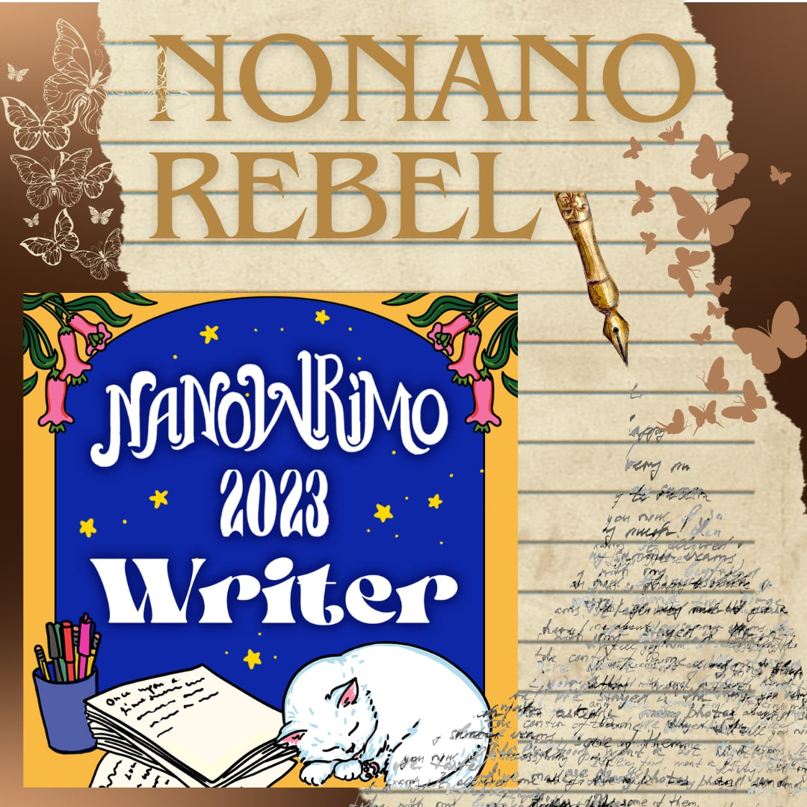
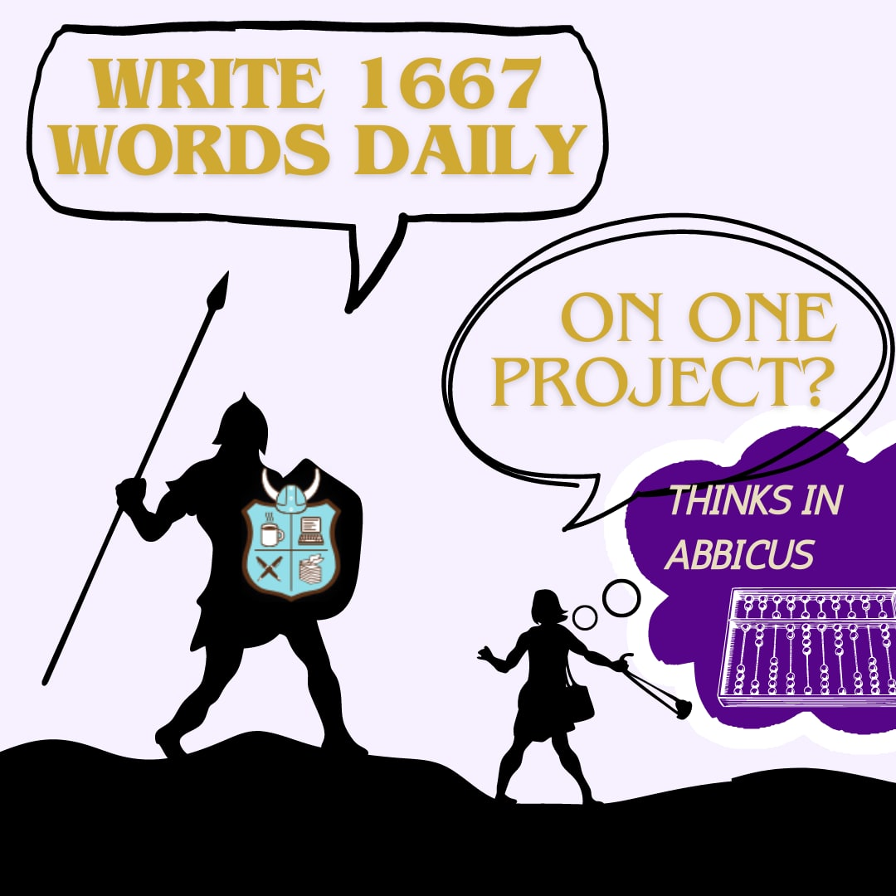
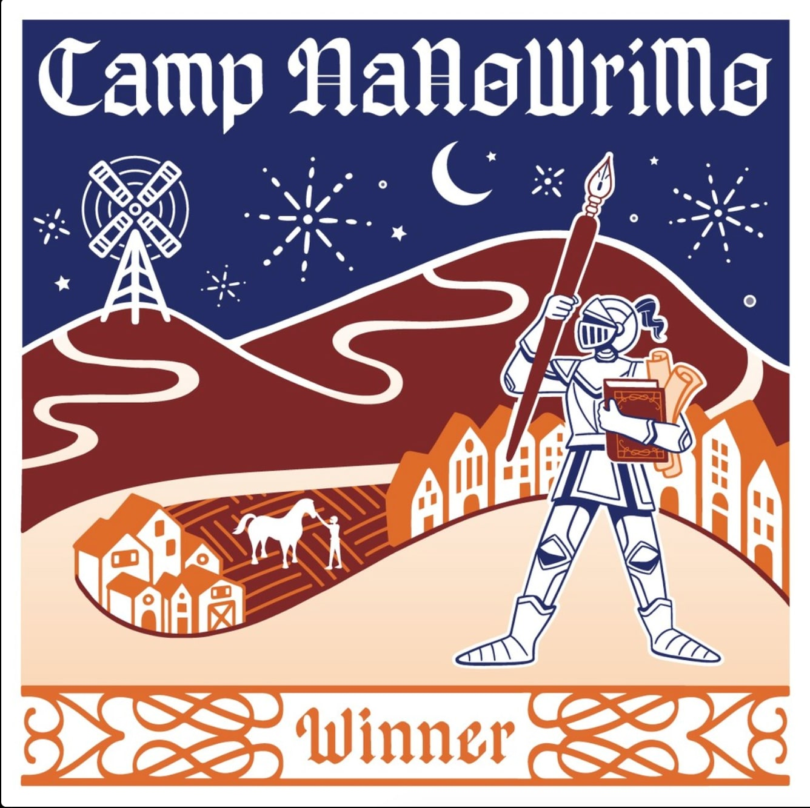
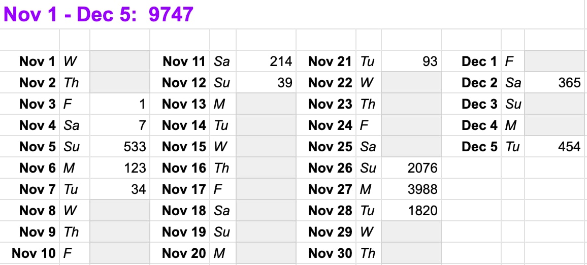
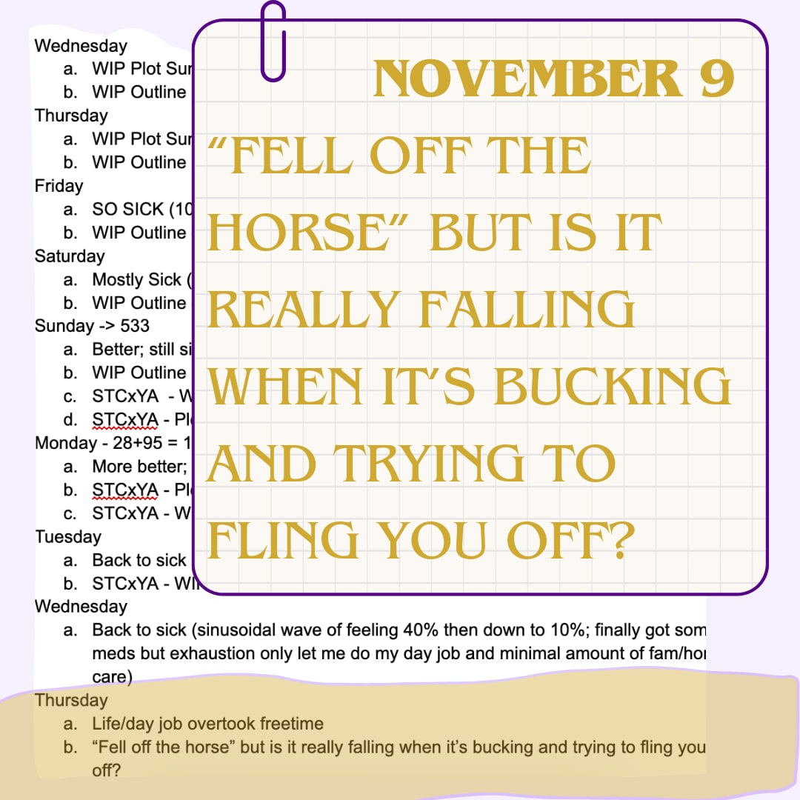
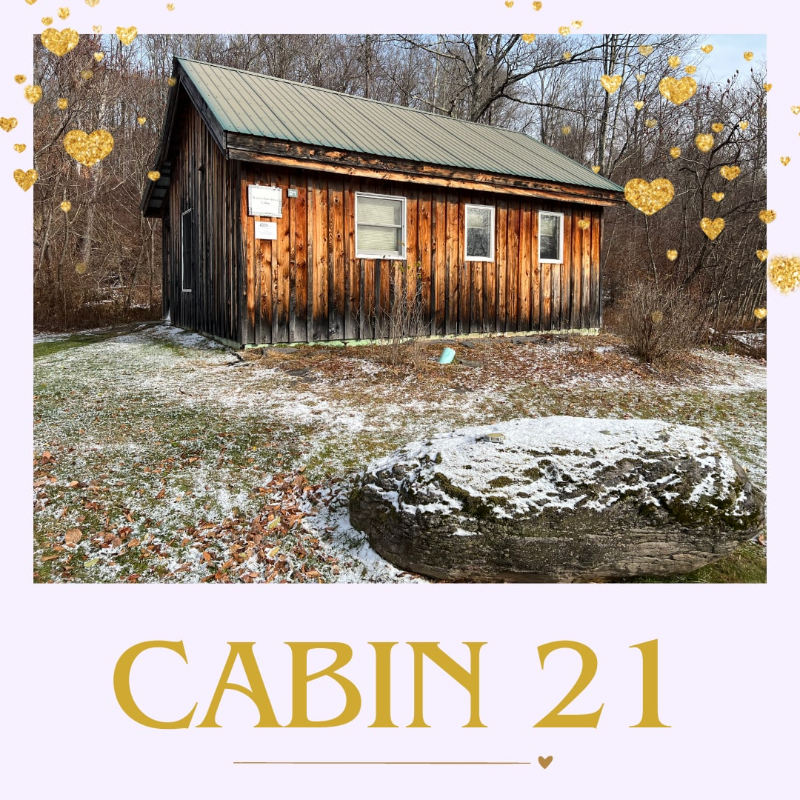
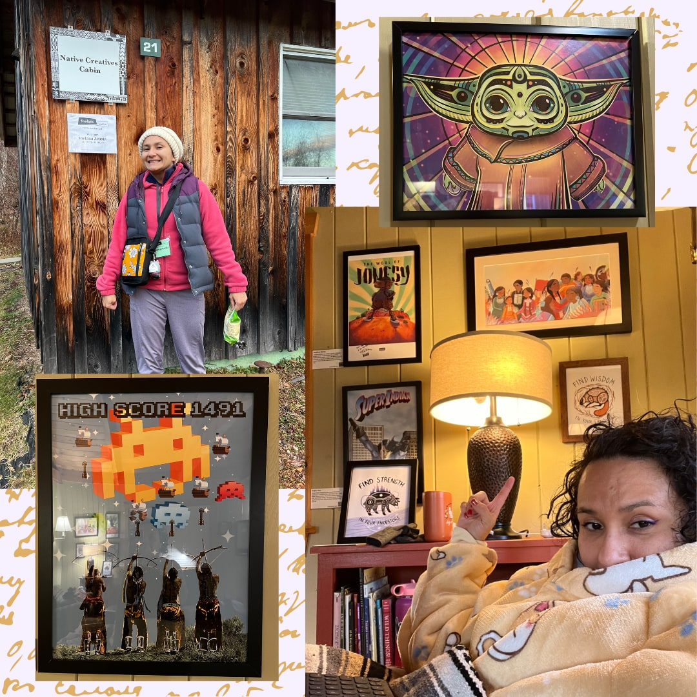
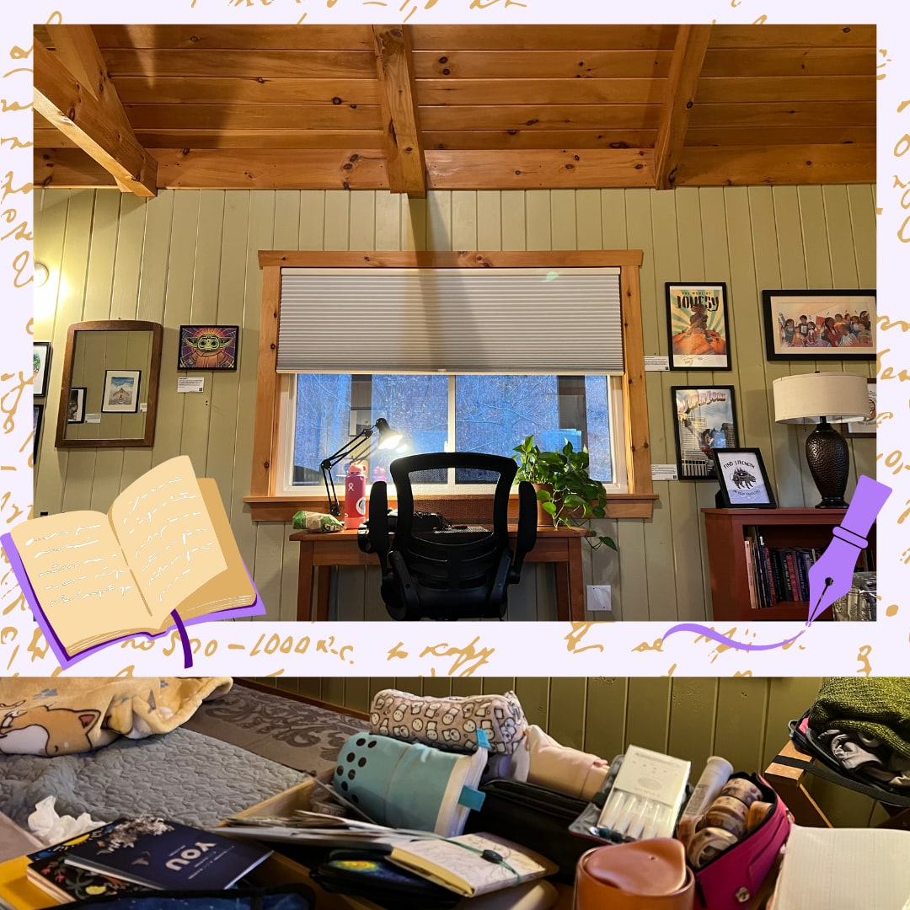
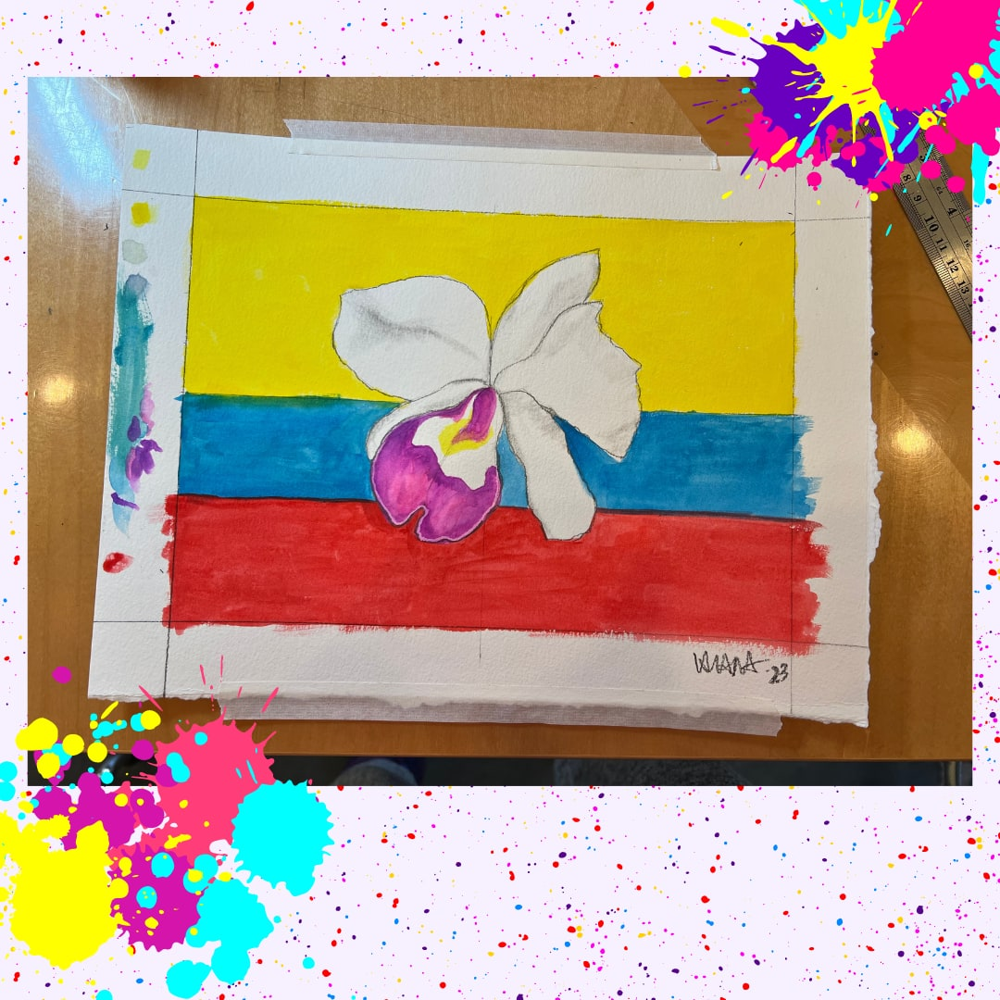
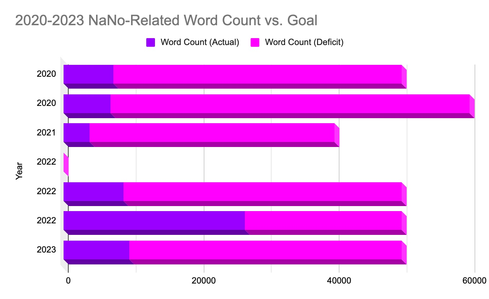

> “It’s quixotic with my reality to dream about accomplishing something so grand.”

[National November Writing Month (NaNoWriMo)](https://nanowrimo.org) gives me anxiety. Writers “win” by completing a 50,000-word novel in about 1700 words a day; meanwhile, I’ve spent over six years to finish a legible draft of my first novel (now on version eight).

I have never “won” nor do I ever anticipate “winning” NaNoWriMo. I take far too long to write, formulate, discover, and re-discover to accomplish pouring out 50,000 words in one month of a cohesive idea. But, the thought beckons every year. I love being swept up in the romantic notion of: what if this is the year? What if I could pour forth onto this liquid crystal display in carpal tunnel-inducing typing a fully formed story?

Even if I had hours of free time, like attending a personal Highlights Foundation retreat (more on that later), I know I can’t stay focused on one story consistently writing to produce 500 words daily let alone 1700. I can write a lot but on different projects. I write non-linearly, either because it’s the time and space I have or because that’s how my mind works (probably a bit of both). So forcing about 1700 words a day on one Goliath project, in my currently available writing time, doesn’t give me room to breathe, to create.

Plus, November is a bad month. Thanksgiving prep (planning, cooking, and family entertaining) and peak season for running races (increased runs and one time-consuming “long” run per week) eat up my “me” time. Still, I try. It’s quixotic with my reality to dream about accomplishing something so grand.

In 2020, I headed my first NaNoWriMo challenge, inspired by my then Stanford Online Writers Certification cohort. That year, since I knew November would be too busy, I decided to do October instead. Also, since 50,000 words is child’s play, for my first NaNo, I’d do 60,000 words. Yea. I netted 6961 words that month.

In 2022, I did a few “camps” where you set lower word count goals. I “won” my April camp.

*April 2022 Camp NaNoWriMo Win!*

Fueled by my April victory, I tried NaNo 2022, even taking a few afternoons off from work to net more time. I mustered about 26,000 words which is pretty impressive by my standards.

This year was probably my worst Nano performance. Ever. Even with setting no goal. This November 2023, I decided to lean into NaNoRebel, where I knew I would not achieve 50,000 words of new words. I hadn’t touched my manuscript in a few weeks, but thought, carried by the Nano spirit, November will be my month to review and plan for revision. I would write those three to four missing scenes.

Then my body said, that’s funny.

This summer I started running again (it’s my exercise torture of choice). I set my eyes on the Philadelphia Half Marathon that also happens to be in November as my first half marathon in over five years. I juggled my writing time against running the right mileage per week. Then, first week of November, some kind of respiratory sickness brought home by my sharing is caring family reminded me of our frail human condition. I went from running twelve miles on a Saturday to being winded walking up the stairs the following Wednesday.

*2023 NaNoWriMo Attempted Word Count (actually November through December 5, 2023)*

I tracked my progress in a Google doc, promising myself grace and patience for days that life would be too hard. I picked up [Save the Cat Writes a Young Adult Novel ](https://bookshop.org/p/books/save-the-cat-writes-a-young-adult-novel-the-ultimate-guide-to-writing-a-ya-bestseller-jessica-brody/17752901?ean=9781984859235)and used it as an initial guide to re-craft my novel’s plot summary, outline, and beat sheet.

Last November 2022, I attended the onsite Highlights Foundation Latinx Retreat but was unable to make the 2023 retreat. Instead, on a whim, I booked a personal retreat for the last days of November 2023, thinking just maybe this year with three glorious days of time, I would finally accomplish 50,000 words of revision, if not new words. Instead, I should have set the wise goal of my writer friend who accompanied me on the personal retreat: “get as much done as I can.”

[Highlights](https://www.highlightsfoundation.org), as echoed by so many of my writer friends, is a magical place. It was cold enough to snow. Even though snow isn’t my favorite, being under blankets inside a warm cabin with nothing but my thoughts, paper and pen, got me back into the right mind set after being sick for so long. Highlights unburdened the guilty feeling of not accomplishing much during my NoNaNo month.

*Highlights Foundation Cabin 21 “Native Creatives Cabin” in late November 2023 under a dusting of snow.*

I stayed in Cabin 21, the Native Creatives Cabin. Cabin 21 is filled with picture books of treasure, telling Native American stories, several of which resonate with my own heritage, and inspiring artwork, combining ancestry and modernity. Cabin 21 has a little porch and overlooks the woods tucked in the furthest corner of campus. Cabin 21 is bliss.

*Absolutely my favorite cabin so far, featuring this incredible stylized Grogu illustration by [Steph Littlebird](https://www.stephlittlebird.com) and Atari Space Invaders mashup by [Stephen Paul Judd](http://www.stevenpauljuddart.com). I’m not religious or spiritual, but this cabin made my soul sing. I felt blessed by the art on the walls and in the shelves.*

In my heart, I’m a city girl. Instinctively, I don’t find the quiet calming, especially at night when it’s too quiet in the woods. That’s how horror stories begin.

The first night, a loud banging kept waking me, and after convincing myself it was not evil trying to get into my room, I summed all my courage, and with my Snuggie hoodie pulled up, I tiptoed up to and opened the door to the frigid night. My flashlight’s beam fell on the unlatched porch door that slapped against the enclosed porch frame with the night wind. Honestly, a part of me was disappointed. I was hoping it was the creative magic literally knocking on my door, waiting to be let in and suffuse my artistic expression. Hoping to ride that horror thrill of revelation, when I, the protagonist, would overcome my inner demons and chart a new path of self-discovery. Instead, I latched the outer door, closed my inner door, and turned on my Calm app to drown out the scary country night noises.

I could be inspired by my surroundings, and I absolutely was, but the real work was within me, as it always was and continues to be. This gift of time was precious and I could not afford to waste it.

*Inside Cabin 21 with a perfect view and all my absolutely necessary stationary supplies.*

I wrote myself several goals in my Hobonichi weeks of what to accomplish over my four-day stay. I wrote things like: complete missing scenes from draft seven, draft a picture book manuscript, paint something, review 2023 projects, and brainstorm new kidlit projects.

I accomplished one of those goals fully: paint something.

*Sketch of a cattleya orchid over the Colombian flag in watercolor I completed at the Highlights Art Coop, open to all not just illustrators.*

In the back of my mind, I’ve this nagging vision, a series of precolombino (as in, pre colonialist Columbus) native art, flowers, animals, and fruits in golden silhouette laid over a Colombian flag. My vision is in oil paints and I finished one over ten years ago with a Colombian precolombino monkey design in palette knife acrylic paint that hangs in my office, but watercolor called to me this time. This is the first painting I’ve done in seven years that wasn’t a kid craft.

Once I found my focus, I did write. I drafted nearly 4,000 words in one day over a few hours. That’s probably the highest daily word count I’ve ever reached on one project. I reemerged into my story and found the threads that connects my scenes, drafted almost all the major missing beats, and now have a plan to revise and complete draft eight for 2024 Q1.

I appreciate I am fortunate and privileged to attend Highlights. That I could decide on a (well-coordinated-with-family-support-structure-in-place) whim to go after Thanksgiving and before the rest of the holiday madness. I wish there were more opportunities for struggling parent writers, disadvantaged people of color, to do just this: claim your own time for your artistic work. I wish this were built into our lives and respected by our capitalistic society, families, and responsibilities that creatives need their time. I wish this happened weekly, not once to twice a year. At least that’s all I can afford in my time-starved world.

Until then, daily writing sprints and Nano-inspired “camps” keep me motivated throughout the year, along with my writing community of virtual friends.

*I’m a data nerd, so I plotted my word count goals vs actual word count for my Nano-related activities. The word count deficit in pink dominates and I can’t find the July 2022 NaNo Camp numbers, but I’m pretty sure it was close to 10,000 words.*

Since 2020, I’ve donated to NaNoWriMo and not just for the pin and stickers that come as gifts but also for the rejuvenating spirit that Nano provides at the end of the year. It’s like sprinting at the end of a long race where you can see the finish line. Except, for me, it’s a timed race and I am still somewhere close to the beginning when the timer warns “five minutes left.”

Writing in my margins of time, I get maybe 30 minutes to 2 hours a day of “me” time not only to write but also to adult, so the math doesn’t math. Even when I “know” what I want to write, I get about 300 words down for about 30 minutes (usually less, but I’m being generous). Across 30 days in a month like November, I can hope for a minimum of 9,000 words if I do one 30 minute session a day and a maximum of 36,000 words if I can get four 30 minute sessions.

My “free” time is exact, as in, within my 30 minutes to two hours per day I decide to exercise, write, sew/knit, draw/paint, or just veg in front of the TV with popcorn and fall asleep because my mind is mush at the end of a long work day bookmarked by childrearing. The only “give” is sleep, and that’s not really a healthy give.

Even with all that reality backed by actual collected data, I still hope, one day, to draft a novel in one month. One day to achieve what [Kazuo Ishiguro did over four weeks](https://www.theguardian.com/books/2014/dec/06/kazuo-ishiguro-the-remains-of-the-day-guardian-book-club) to write [Remains of the Day](https://bookshop.org/p/books/the-remains-of-the-day-kazuo-ishiguro/6713500?ean=9780679731726), but like Stephen King and [his writing practice of 1,000 words a day](https://bookshop.org/p/books/on-writing-a-memoir-of-the-craft-stephen-king/14560198?ean=9781982159375), writing with the door closed, they both had supportive spouses who took care of their share of adulting and parenting to enable their artistic soul.

Until my village shows up to take care of my responsibilities, I think I’ll add writing a novel in a month as a bucket list item.
