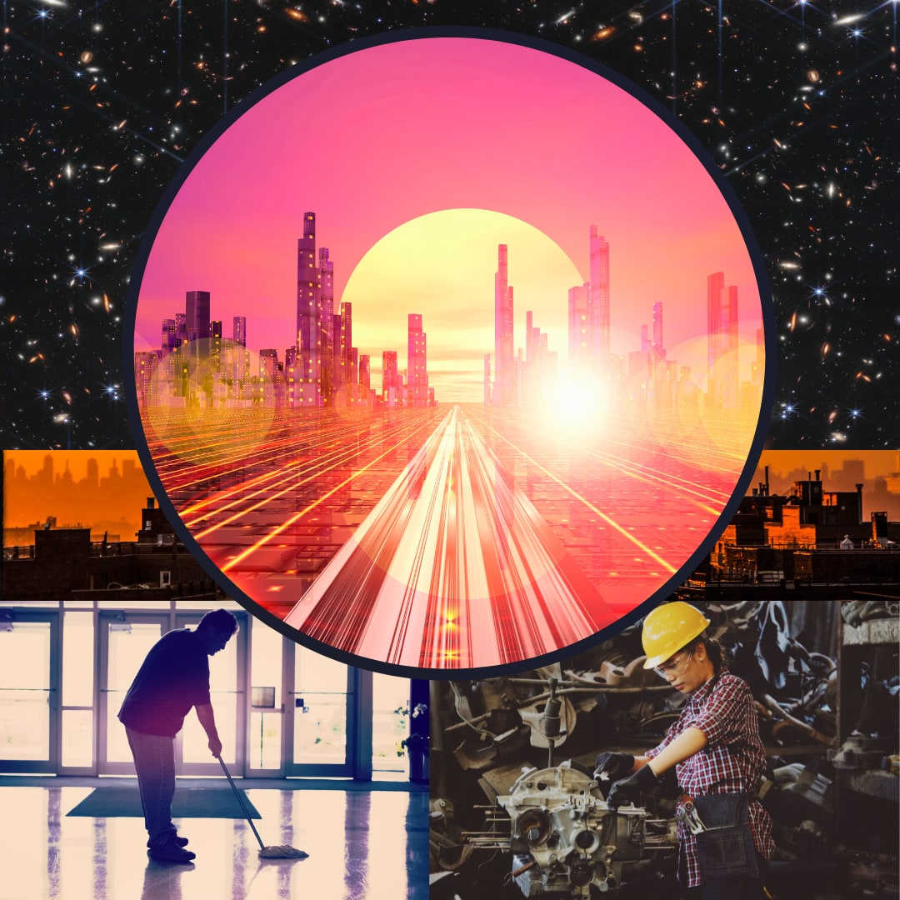

*Science Fiction + Inmigrantes = SciFimigrantes*

I never understood why Science Fiction falls into the category of Fantasy. How does inspiring intergalactic travel, solving how humanity can survive on other planets, and just in general theorizing tangible answers to the “what ifs” of future space adventures fit in the same realm as fairies, elves, and enchanted kingdoms? Is it really a compliment to SciFi if people think otherworldly possibilities are only accessible via magic?

Then I discovered Speculative Fiction and fell in love.

Finally, I felt at home, where the worlds the authors brilliantly spin are like ours – except for a simple but dramatic change. Like in many of works by the greats in Afrofuturism – the greats like Octavia Butler, N.K. Jemisin, Nalo Hopkinson - these great female creatives make worlds parallel to our own and create beauty and horror too true to be real. 

When I started my first novel, I knew it had elements of SciFi and Speculative Fiction. It’s a world that actually could happen, set three hundred years in the future, post climate change environment where those living near the tropics will have no home. My story amplifies the notion of ancestral wealth to the extreme, for the destitute refugees and the privileged upper strata, where humanity’s salvation lies on a habitable exoplanet lightyears away.

But for that working single mother of three children, she only knows hard labor, whether it be from selling handmade arepas at an open air market (setting up her spot at 5 am to ensure she gets seen first) back in her country of origin before its destruction to making the arduous journey to another country, with a different language and culture, just so she can clean toilets in the late hours so as to not disturb the white collar executives? What about her? How does her story fit into SciFi or Speculative Fiction?

It didn’t feel enough. Those literary categories could not truly encompass the diaspora aspect of the Latine experience, specifically the burdens on our women. Shared by all cultures alike, our mothers, aunts, sisters, and cousins are assumed caretakers by society, regardless of the socioeconomic level. The difference is the support - zero for the underprivileged and innumerable servants for the wealthy. And who serves the wealthy females? The same underprivileged female.

One night, writing in the early hours, a term came to my mind that felt, well, still not right, but closer. 

Science Fiction + Inmigrantes =  SciFimigrantes.

There it was. My analytical Spanglish mind had it. Finally, I found a term to describe the world in which my characters live. A world like my own, like that of my youth, like that of my and my family’s experiences traveling through unknown environments in different languages and foreign customs. Even after years of faking, adapting, and assimilating, I find myself perplexed by “common” idioms and smile and nod, pretending I understand.

For these SciFimigrants, what are their challenges? What is worse for them in the future? What’s better? How does technology enable their world? How does it make it worse? What kind of access do they have and what are barred from them? Most importantly, how did it start? When did it start? What thread in current events can be extrapolated into the future and be the origin for something great or maybe devastating? 

Apply the same obstacles to the two polar sides of the socioeconomic ladder and there are fundamental challenges that cannot be overcome with money, such as keeping our children safe from the bullies and themselves, and other impediments that money equates to survival, such as potable water, breathable air, and shelter from hazardous environments.

I concentrate my ideation on “what’s better” to spring hope in my characters, faced with obstacles all too relatable to my own and those in my community. To acknowledge the privilege and identify how and when and where we can help.

SciFimigrantes is not Fantasy. To me, it’s my reality across my family’s generations. 

To my grandmother, who had three children by the time she was nineteen and escaped an abusive relationship. She worked in grape plantations, being rained upon by chemicals by crop dusters, while cutting vines.

To my mother, who worked two jobs as a single mom to get me through school. 

And for my daughter, I’ve given her a sheltered world, where she knows no want, no uncertainty, no fear of having to leave your home suddenly or find your loved ones vanish. 

I am their Science Fiction made real. 

And that’s as far from witches and knights in shining armor as it can get.
